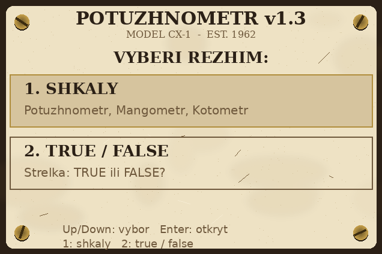
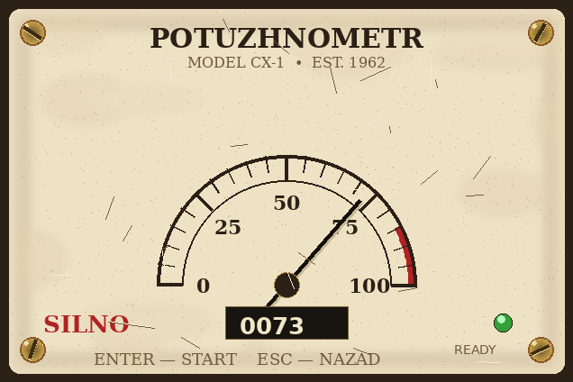
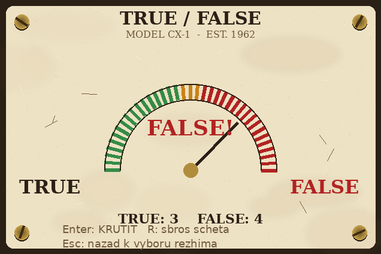

# Potuzhnometr for TI-Nspire CX


Шуточный симулятор-измеритель «потужности» для калькулятора **Texas Instruments TI-Nspire CX (1st gen)** — клон одноимённого iOS-приложения. Стрелка, шкала, случайный результат и взрыв при перегрузке.

> **A fun meme-meter simulator for the TI-Nspire CX.** It measures nothing real — the value is random, just like in the original app.

## Дизайн

Приложение оформлено в стиле **старого счётчика Гейгера**: кремовая панель с потёртостями и царапинами, латунные винтики по углам, цифры с засечками, красная опасная зона на шкале и механическое окошко счётчика, в котором показывается значение. На самом калькуляторе текстуры упрощены (Lua рисует только плоские фигуры), но общий вид — тот же.

## Скриншоты

*Мокапы экранов — так приложение выглядит на калькуляторе (окно Lua 318×212).*

| Выбор режима | Измерение | TRUE / FALSE |
|---|---|---|
|  |  |  |

## Возможности

### Два режима при запуске

1. **SHKALY** — классический потужнометр: стрелка по полукруглой шкале.
2. **TRUE / FALSE** — шкала «правда или ложь»: слева зелёная зона TRUE, справа красная FALSE. Стрелка крутится и останавливается на одном из двух вариантов (50/50).

### Режим шкал

- Три готовые шкалы: **POTUZHNOMETR** (PW, max 100), **MANGOMETR** (MG, max 100), **KOTOMETR** (KT, max 100).
- **Свои шкалы**: любое количество, с названием (до 14 символов), единицей измерения (до 4 символов), максимумом (10–1000) и критическим порогом (50–99%). Создаются, редактируются и удаляются прямо на калькуляторе и **сохраняются в документе** (`.tns`).
- Цветные зоны шкалы (зелёная / жёлтая / красная), вердикты: `SLABO`, `NORM`, `HOROSHO`, `SILNO`, `POTUZHNO!`.
- Если выпало больше максимума — шкала **«взрывается»**: `BOOM! VZRYV!`
- Ручная подкачка стрелкой вверх.

### Режим TRUE / FALSE

- Enter — крутить стрелку, результат случайный: TRUE или FALSE.
- Счётчик `TRUE: N  FALSE: M` внизу экрана, сохраняется в документе.
- `Left` / `Right` — поставить стрелку вручную (в счёт не идёт), `R` — сбросить счёт.

## Установка

Готовый файл — **`potuzhnometr.tns`**, его и нужно копировать на калькулятор.

1. Подключите TI-Nspire CX к компьютеру по USB.
2. Откройте TI-Nspire CX Student Software (или [N-Link](https://github.com/lights0123/n-link)).
3. Скопируй `potuzhnometr.tns` в память калькулятора.
4. На калькуляторе открой документ — скрипт запускается сам, когда страница со скриптом активна.

Требования: OS **3.0.2 или новее**. Для CX 1-го поколения последняя версия — **4.5.5.79**, на ней проверено.

## Управление

Весь интерфейс — только латиницей / транслитом, чтобы не было проблем со шрифтами кириллицы на Nspire.

### Выбор режима

| Клавиша | Действие |
|---|---|
| `Up` / `Down` | Выбор: 1. SHKALY или 2. TRUE / FALSE |
| `Enter` | Открыть выбранный режим |
| `1` | Сразу шкалы |
| `2` или `T` | Сразу TRUE / FALSE |

### Меню шкал

| Клавиша | Действие |
|---|---|
| `Up` / `Down` | Выбор шкалы |
| `Enter` | Открыть измерение |
| `N` | Новая своя шкала |
| `E` | Редактировать выбранную шкалу |
| `D` | Удалить выбранную шкалу (останется хотя бы одна) |
| `H` | Помощь |
| `Esc` | Назад к выбору режима |

### Измерение

| Клавиша | Действие |
|---|---|
| `Enter` / `Space` | Старт / стоп |
| `Up` | Ручная подкачка |
| `R` | Сбросить значение в 0 |
| `Esc` / `B` | Назад в меню |

### TRUE / FALSE

| Клавиша | Действие |
|---|---|
| `Enter` / `Space` | Крутить стрелку |
| `Left` | Стрелка на TRUE (вручную, без учёта в счёте) |
| `Right` | Стрелка на FALSE (вручную, без учёта в счёте) |
| `R` | Сбросить счёт TRUE / FALSE |
| `Esc` / `B` | Назад к выбору режима |

### Редактор своей шкалы

| Клавиша | Действие |
|---|---|
| `Up` / `Down` | Выбор поля |
| `Left` / `Right` | Изменить MAX / KRIT % |
| `Del` | Стереть последний символ в NAME / UNIT |
| `Ctrl` + `Clear` | Стереть всё поле NAME / UNIT |
| `Enter` | Следующее поле, на последнем — сохранить |
| `Esc` | Отмена (не сохранять) |

Пример своей шкалы: `NAME: TEST`, `UNIT: DR`, `MAX: 100`, `KRIT %: 85`.

## Сборка из исходников

Исходник — `potuzhnometr.lua` (Lua 5.1, `platform.apiLevel = "2.0"`).

Сборка `.tns` — [Luna 2.1](https://github.com/ndless-nspire/Luna):

```bash
luna potuzhnometr.lua potuzhnometr.tns
```

## Структура проекта

```
.
├── potuzhnometr.lua            # исходный код (Lua 5.1, API 2.0)
├── potuzhnometr.tns            # готовый .tns
├── README.md                   # этот файл
└── docs/
    └── screenshots/            # мокапы экранов
        ├── screenshot-select.png
        ├── screenshot-measure.png
        └── screenshot-truefalse.png
```

## Ограничения

- Звука нет: у калькулятора нет динамика, взрыв — только анимация.
- Проверено на реальном TI-Nspire CX 1-го поколения (v1.2 работает, включая `Del` и режим TRUE / FALSE). Версия 1.3 на реальном калькуляторе пока не проверялась.

---
